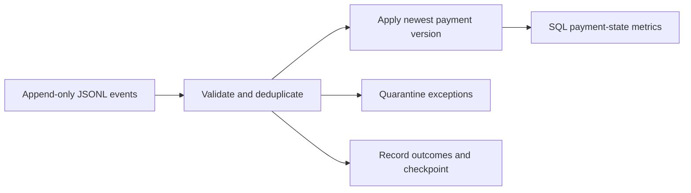

# Payment Event Monitoring Pipeline

A Python and SQLite portfolio project modeled on payment streaming, production monitoring, and SQL data quality work. It uses synthetic data and runs locally with Python 3.10+ and the standard library.



## Run the demo

```bash
python pipeline.py events.jsonl --db payments.sqlite --limit 2
python pipeline.py events.jsonl --db payments.sqlite
python pipeline.py events.jsonl --db payments.sqlite
python -m unittest -v
```

The first two runs process 2 and 4 records. The third processes zero because ingestion resumes at the saved byte offset. A complete line is required before an event is processed.

| Outcome across all runs | Count |
| --- | ---: |
| Applied | 3 |
| Duplicate | 1 |
| Stale | 1 |
| Invalid event | 1 |

The final state is one settled payment worth $25.00 and one authorized payment worth $5.00. Amounts are stored as integer cents. The invalid record is kept in the exceptions table with its source offset and rejection reason.

## Design decisions

- Event IDs detect exact retries and conflicting reuse. Event versions prevent late records from overwriting newer state. Producers should supply a consistent, increasing version for each payment.
- State changes, exceptions, outcome records, and the checkpoint commit together. A failed write rolls back the batch so a retry can resume safely.
- The local source must remain append-only at the same path. The demo detects truncation when the saved offset exceeds the current file length. Use a new database to replay a replaced file from the beginning.
- This demo models streaming ingestion using a file and a single local database. A production mapping would use Kafka partitions and consumer offsets, Spark Structured Streaming for distributed processing, and a durable destination such as Delta Lake.

```sql
SELECT reason, COUNT(*) AS event_count
FROM exceptions
GROUP BY reason;
```

